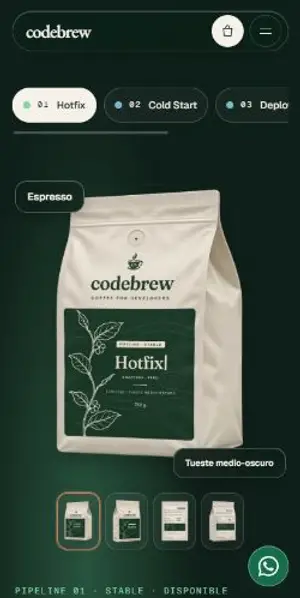

# Línea base de rendimiento (S5.1)

Medición del 13 de noviembre de 2026 sobre la versión **1.7.0**, antes de cualquier optimización del catálogo. Sirve de referencia para las historias de la épica E5 (#118 presupuesto de JS, #100 catálogo desde la BD, #104 caché) y para comprobar que no retrocedemos.

## Presupuestos

| Métrica | Presupuesto | Dónde se mide |
|---|---|---|
| LCP | < 2,5 s | Lighthouse móvil, producción |
| INP | < 200 ms | Datos de campo (CrUX/GA4) cuando haya tráfico; en laboratorio se usa TBT como aproximación |
| CLS | < 0,1 | Lighthouse móvil y escritorio, producción |
| JS inicial de la portada | ≤ 80 KB gzip | `pnpm perf:budget` en CI (job de integración, #118) |
| JS inicial del producto | ≤ 80 KB gzip | Ídem |
| JS inicial del checkout | ≤ 120 KB gzip | Ídem; three y gsap no pueden entrar en el JS inicial de ninguna de las tres |

## Resultados

### Lighthouse (producción, https://coffeecodebrew.com)

| Página | Dispositivo | Rendimiento | FCP | LCP | TBT | CLS | Peso |
|---|---|---|---|---|---|---|---|
| `/` | Móvil | 79 | 2,69 s | **3,56 s** ❌ | 18 ms | **0,147** ❌ | 479 KB |
| `/` | Escritorio | 99 | 0,52 s | 0,80 s | 0 ms | 0,001 | 492 KB |
| `/producto/hotfix` | Móvil | 80 | 2,98 s | **4,18 s** ❌ | 0 ms | 0,005 | 406 KB |
| `/producto/hotfix` | Escritorio | 88 | 0,59 s | 0,70 s | 0 ms | **0,217** ❌ | 382 KB |

Accesibilidad, buenas prácticas y SEO: **100** en las cuatro mediciones.

Con la build de producción en local (sin red ni CDN), el móvil da 76 en `/` (LCP 4,97 s) y 87 en `/producto/hotfix` (LCP 3,62 s), con CLS ≈ 0. Las cifras locales salen peores en peso porque el servidor Node no comprime; en producción comprime Nginx.

| Portada móvil | Producto móvil |
|---|---|
|  |  |

Carga de la portada en móvil, un cuadro cada ~0,56 s: la pantalla está en blanco hasta ~1,7 s y luego aparece completa.


### JavaScript inicial por página

Scripts del HTML más sus importaciones estáticas (sin `import()` dinámicos), sobre la build de producción.

| Página | Archivos | Tamaño | gzip | three | gsap |
|---|---|---|---|---|---|
| `/` | 10 | 228,9 KB | **73,5 KB** | no | no |
| `/producto/hotfix` | 11 | 231,8 KB | 74,9 KB | no | no |
| `/checkout` | 12 | 356,7 KB | **112,4 KB** | no | no |

- **three y gsap no entran en la portada ni en ninguna página**: ningún archivo de `dist/client/_astro` los contiene, porque los componentes 3D reservados (`CoffeeExperience3D`, `Experience`, `WorldStage`) no se montan en ninguna página. El criterio de #118 («landing sin three/gsap en el bundle inicial») ya se cumple; falta el paso de CI que lo vigile.
- El 87 % del JS de la portada es **React DOM** (`client.*.js`, 64,3 KB gzip), que se carga en todas las páginas para la isla del carrito del header (`CartWidget`).
- En el checkout, **zod** (`schemas.*.js`) suma 35,2 KB gzip.
- CSS: una sola hoja de 14,2 KB gzip, que bloquea el render.
- Fuentes: 4 archivos, 143 KB en total (EB Garamond normal 44 KB e itálica 47 KB, Geist 29 KB, Geist Mono 23 KB).

### TTFB

12 peticiones por ruta, mediana (p90).

| Ruta | Local (build de producción) | Producción |
|---|---|---|
| `/` | 6 ms (7) | 519 ms (880) |
| `/producto/hotfix` | 5 ms (6) | 458 ms (511) |
| `/checkout` (prerenderizada) | 3 ms (3) | 491 ms (519) |
| `/api/health` | 4 ms (4) | 447 ms (499) |

Renderizar en el servidor cuesta milisegundos. Los ~450–500 ms de producción aparecen igual en `/api/health`, que no hace casi nada, y en `/checkout`, que es HTML estático: el tiempo se va en el viaje Cloudflare → origen. Cloudflare responde `cf-cache-status: DYNAMIC`, es decir, no guarda nada en el borde.

## Diagnóstico

- **LCP móvil.** El elemento LCP es la bolsa Hotfix (`hotfix-front-*.webp`, con `fetchpriority="high"`). En la portada el LCP se reparte en TTFB 560 ms, espera para pedir la imagen 687 ms, descarga 502 ms y **1 813 ms de demora de render**. En el producto: TTFB 810 ms, espera 1 286 ms y descarga 1 997 ms. La hoja CSS bloqueante (~470–590 ms según Lighthouse) y la ejecución de React DOM en un móvil con CPU limitada explican parte de la demora; falta confirmarlo con un perfil de rendimiento.
- **CLS.** Solo aparece en producción: 0,147 en la portada móvil (`.cb-orbit` del hero) y 0,217 en el producto en escritorio (`.cb-gallery`). En local, con las fuentes cargadas al instante, es ≈ 0. La hipótesis es el cambio de la fuente de respaldo (Georgia/sistema) a EB Garamond y Geist con `font-display: swap`, que cambia la altura de los titulares y empuja el escenario.
- **TTFB.** Domina la latencia hasta el origen, no el render.

## Mejoras priorizadas

| # | Mejora | Impacto esperado | Historia |
|---|---|---|---|
| 1 | Caché en Cloudflare o microcaché en Nginx para HTML prerenderizado y `/_astro/*` | −400 ms de TTFB en páginas estáticas; ayuda a LCP | #104 (S5.5), #120 (S8.1) |
| 2 | Corregir el CLS del cambio de fuente: métricas de respaldo (`size-adjust`, `ascent-override`) o reservar el alto del escenario | CLS < 0,1 en portada móvil y producto escritorio | Nueva, o dentro de #99/#103 |
| 3 | Reducir la demora de render del LCP: CSS crítico del hero en línea o dividir la hoja; confirmar con un perfil si React DOM la alarga | LCP móvil hacia < 2,5 s | #99 (S5.2) |
| 4 | No cargar React DOM en todas las páginas solo por el carrito: isla `client:idle` o widget sin React | −64 KB gzip de JS inicial | #118 (S5.7), #101 (S5.4) |
| 5 | Paso de CI con presupuesto de JS por página (valores de esta tabla) | Evita regresiones | #118 (S5.7) |
| 6 | Revisar zod en el checkout (`zod/mini` o validar solo lo necesario en el cliente) | −20 a −30 KB gzip en `/checkout` | Después de #77 (S1.9) |
| 7 | Subconjunto o carga diferida de la itálica de EB Garamond (47 KB, una palabra por titular) | Menos peso en móvil | — |
| 8 | Ajustar `sizes`/`srcset` de las bolsas que Lighthouse marca (≈130–190 ms) | Menor | — |

## Cómo repetir la medición

```bash
pnpm build
PORT=4399 HOST=127.0.0.1 node --env-file=.env dist/server/entry.mjs   # requiere la BD de desarrollo
# Lighthouse 12.8 con Chromium, perfil móvil por defecto (Moto G Power, 4G lenta, CPU ×4) y --preset=desktop
npx lighthouse https://coffeecodebrew.com/ --only-categories=performance,accessibility,best-practices,seo --output=json
npx lighthouse https://coffeecodebrew.com/ --preset=desktop --output=json
# TTFB: 12 peticiones por ruta, mediana y p90
for i in $(seq 1 12); do curl -s -o /dev/null -w "%{time_starttransfer}\n" https://coffeecodebrew.com/; done
```

Cada cifra de Lighthouse es una sola corrida, así que pueden variar unos puntos entre ejecuciones. Para comparar una mejora, conviene correr 3 veces y tomar la mediana.
