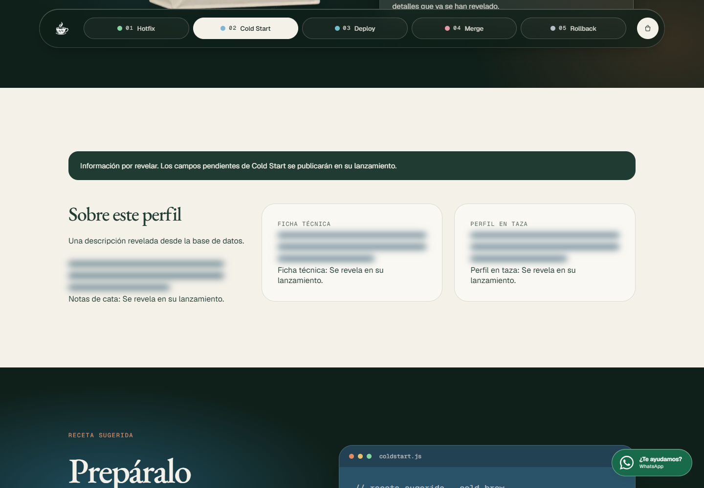
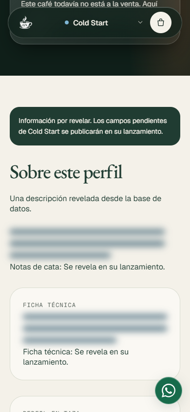
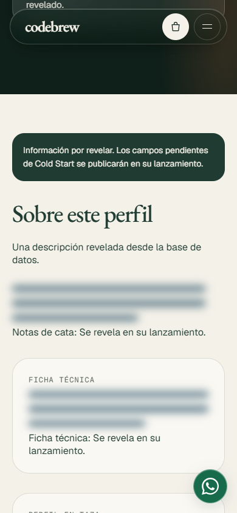

# S5.8 — Campos revelados de productos próximos

Issue: [#102](https://github.com/CFCamusDev/code-brew/issues/102). Verificación local del 17 de noviembre de 2026.

- Tipos, arquitectura, 283 pruebas unitarias y build verificados en local.
- Prueba de `RevealField` con Astro Container: contenido revelado visible; slot oculto ausente y marcadores con `aria-hidden`.
- Integración con PostgreSQL: campos privados ausentes de HTML y API, revelado parcial, revelado completo y producto activo en las plantillas base y Pipeline.
- `pnpm test:docker` correcto: imágenes, salud de PostgreSQL/app/Nginx, tipos, migraciones, 283 pruebas unitarias y 88 pruebas de integración aprobadas; 10 omitidas por la configuración del stack de pruebas. El CI ejecuta además los escenarios de FakeGateway.
- Chrome sobre el stack local Docker: se actualizó `revealed_fields`, se recargó la página y apareció la descripción mientras ficha y notas siguieron ocultas. La imagen de la app permaneció idéntica durante la prueba: no hubo recompilación ni despliegue.
- Verificado también sin JavaScript, a 1440 px y a 390 px, sin desbordamiento horizontal ni errores JavaScript. Datos originales restaurados al terminar.
- Presupuesto de JS: portada 74.3/80 KB, producto 76.3/80 KB y checkout 112.7/120 KB gzip.
- Auditoría de dependencias con la excepción existente del proyecto; no se añadieron dependencias ni migraciones.

## Capturas

Pipeline a 1440 px, con la descripción revelada y los demás detalles pendientes:

Pipeline a 390 px:

Plantilla base a 390 px:

