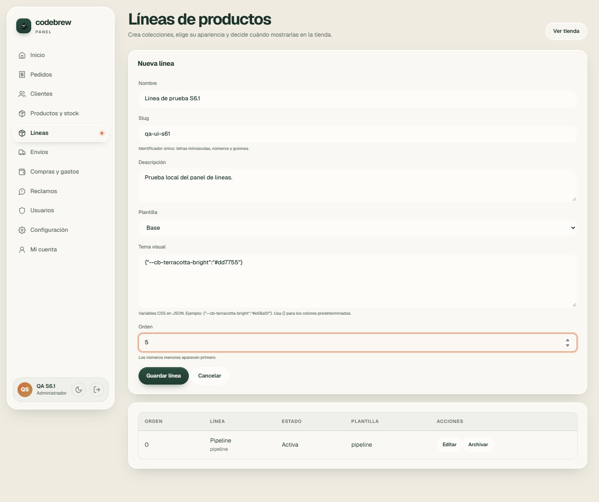
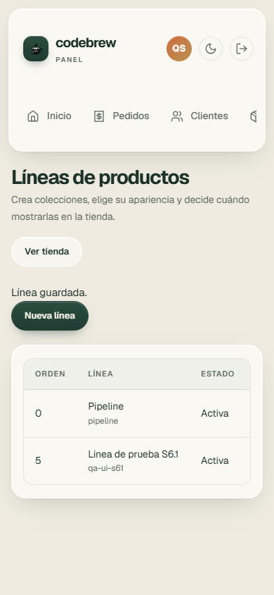

# S6.1 — Administración de líneas

Issue: [#106](https://github.com/CFCamusDev/code-brew/issues/106).

Validación inicial del 17 de noviembre de 2026 (antes de la revisión de alcance):

- `pnpm typecheck`, `pnpm deps:check`, `pnpm test` (291 pruebas) y `pnpm build` correctos.
- `pnpm audit --audit-level=high` correcto con la excepción ya documentada en el proyecto.
- `pnpm test:docker`: imagen construida, PostgreSQL, app y Nginx saludables; migraciones verificadas; 291 pruebas unitarias y 93 de integración aprobadas. Diez pruebas de pasarela se omiten en este stack porque no configura FakeGateway; el job de integración del CI sí lo configura.
- `node scripts/perf/js-budget.mjs http://localhost:8080`: portada, producto y checkout dentro de sus presupuestos.
- Chrome local sobre `pnpm local:up`: inicio de sesión, creación, edición, rechazo de activación sin productos, activación con producto próximo, visibilidad en `/tienda`, archivado y ocultación. Sin errores JavaScript.
- Revisado a 1440 px y 390 px. Corregido el desbordamiento del menú del panel; comprobado que panel y tienda no exceden el ancho móvil. La tabla conserva desplazamiento horizontal interno.
- Los usuarios, productos y líneas creados para la comprobación del navegador se eliminaron al terminar.

## Capturas

Formulario a 1440 px:

Panel a 390 px:

## Correcciones de revisión

- Actualizada la rama con los cambios de `develop` y de la rama remota.
- Retirados `/tienda`, el cambio del header y `listPublicLineSlugs`: esa implementación corresponde a #105 / PR #170.
- Conservada la prueba de visibilidad en `/tienda`; se marca como pendiente mientras la ruta de S5.6 no exista en el checkout y se activa automáticamente cuando se integra.
- El slug solo puede cambiar en borrador. La API comprueba el estado bajo bloqueo de fila dentro de la misma transacción de edición; un rechazo no guarda los demás cambios. El panel muestra el slug como solo lectura fuera de borrador.
- Pruebas adicionales para renombrar un borrador, rechazar cambios en líneas activas y archivadas y conservar `pipeline` en la portada y su endpoint público.
- Documentación reorganizada e ícono propio para Líneas.
