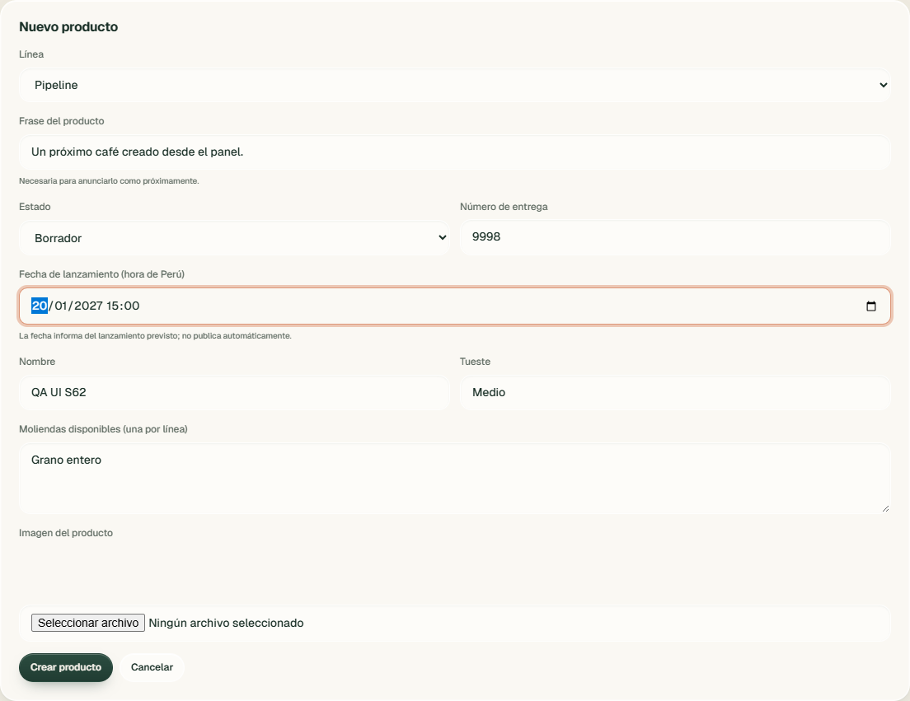
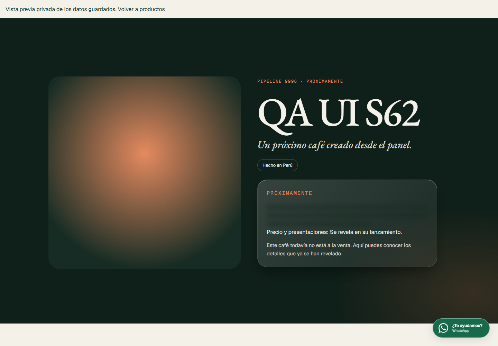
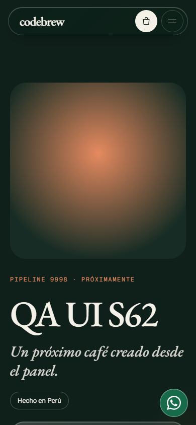

# S6.2 — Productos dentro de una línea

Issue: [#108](https://github.com/CFCamusDev/code-brew/issues/108). Verificación local del 17 de noviembre de 2026.

- Tipos, arquitectura, 324 pruebas unitarias, build y auditoría con la excepción existente verificados. Sin nuevas dependencias ni migraciones.
- `pnpm test:docker`: imágenes, salud de PostgreSQL/app/Nginx, migraciones, 324 pruebas unitarias y 113 de integración aprobadas. Diez pruebas se omiten por configuración de la pasarela de ese stack; el CI configura también FakeGateway.
- Integración HTTP/PostgreSQL: permisos, línea inexistente, datos inválidos, creación de borrador, privacidad de la vista previa, anuncio con frase mínima, fecha con zona horaria, número repetido, slug estable, rollback y transiciones inválidas.
- Se crea un producto de Pipeline sin renders propios y se comprueba respuesta 200 en portada, tienda y página de producto. Como próximo no presenta botón de compra. La prueba usa la página real y no solo la API.
- Chrome en el ordenador: alta desde el formulario, vista previa autenticada en otra pestaña, paso a próximo, fecha conservada en hora de Perú y producto visible en las tres páginas. Revisado a 1440 px y 390 px sin desbordamiento horizontal ni errores JavaScript.
- Los productos y la cuenta temporal de la prueba del navegador se eliminaron al terminar.

## Capturas

Alta a 1440 px:

Vista previa privada:

Producto próximo a 390 px, usando la plantilla base al no tener renders propios:

