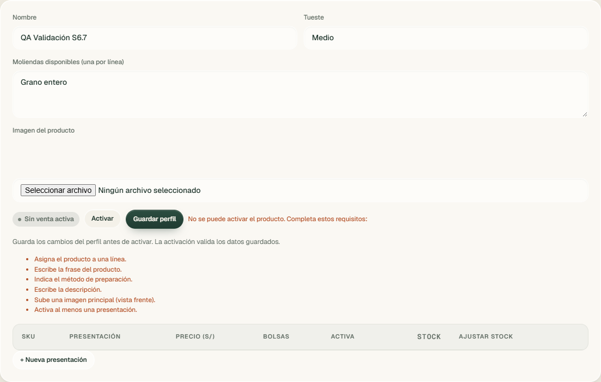
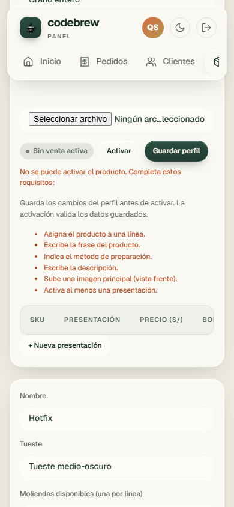
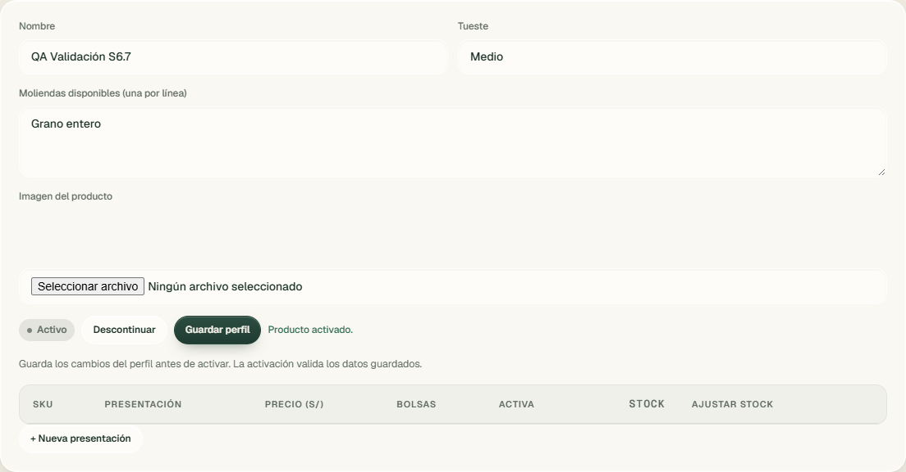

# S6.7 — Validación de publicación

Issue: [#107](https://github.com/CFCamusDev/code-brew/issues/107). Verificación local del 17 de noviembre de 2026.

- `pnpm typecheck`, `pnpm deps:check`, `pnpm test` (292 pruebas) y `pnpm build` correctos.
- `pnpm audit --audit-level=high` correcto con la excepción existente del proyecto. Sin nuevas dependencias ni migraciones.
- `pnpm test:docker`: imágenes y servicios saludables, tipos, migraciones, 292 pruebas unitarias y 91 de integración aprobadas; 10 omitidas por la configuración de pasarela de ese stack. El job de integración del CI configura FakeGateway.
- Pruebas HTTP con PostgreSQL: permisos de administrador, códigos y mensajes de todos los faltantes, rechazo de imágenes de reverso como imagen principal, requisitos de precio, activación, fecha estable y descontinuación. La ruta de edición anterior no elude las reglas y revierte los cambios si la publicación falla.
- Chrome local: inicio de sesión, seis faltantes en una lista accesible, activación después de completar los datos, consulta de la API pública y descontinuación. Sin errores JavaScript. Fixtures y cuenta temporal eliminados al terminar.
- Verificado a 1440 px y 390 px. Ajustadas las grillas del panel y sus controles de formulario para mantener los mensajes legibles sin desbordamiento horizontal; las tablas conservan desplazamiento interno.
- Presupuesto de JS local: portada 74.3/80 KB, producto 76.3/80 KB y checkout 112.7/120 KB gzip.

## Capturas

Faltantes a 1440 px:

Faltantes a 390 px:

Activación correcta después de completar los datos:

